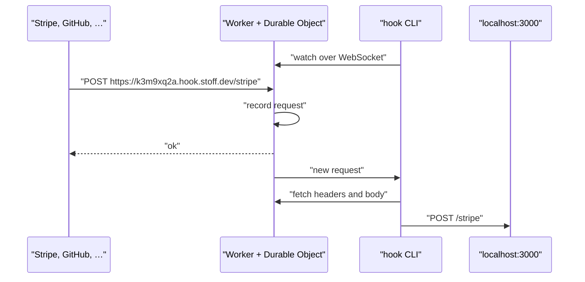

<div align="center">


# hook

**Webhooks, caught and replayed.**

A URL that records every request, sends it to localhost and replays it whenever you like. No accounts.

[](https://github.com/Stoffbergie/hook/actions/workflows/deploy.yml)
[](https://workers.cloudflare.com)
[](#install)
[](./LICENSE)

[Website](https://hook.stoff.dev) · [How it works](#how-it-works) · [Issues](https://github.com/Stoffbergie/hook/issues)

</div>

---

Run one command, paste the URL into Stripe, GitHub or anything else that sends webhooks, and watch them arrive. Add `--to 3000` and each one is delivered to your local server too. Missed one while your server was down? Replay it.

```console
$ hook --to 3000
https://k3m9xq2a.hook.stoff.dev → localhost:3000
Requests appear below. Watch in a browser: https://hook.stoff.dev/k3m9xq2a#5Yc0…
POST    200  /stripe 31ms
POST    -    /stripe nothing answered on localhost:3000
```

## Features

- **One command.** `hook` gives you a URL that records every request and replies `ok`.
- **Delivered to localhost.** `hook --to 3000` sends each request to your server as it arrives, with its method, path, headers and body.
- **Replay anything.** Send a recorded request again, signature headers and all, even if it arrived while your server was down.
- **Watch in a browser.** Each hook has a link that shows requests live, with headers and bodies.
- **Scriptable.** Create a hook and read what arrived with plain curl, so scripts and AI agents can use it too.
- **Picks up where it left off.** Laptop sleeps, Wi-Fi drops, hook reconnects and delivers what it missed.

## Install

```sh
brew install stoffbergie/tap/hook
```

For direct [Linux downloads](https://github.com/Stoffbergie/hook/releases/latest), the GNU x86_64 and ARM64 archives require glibc 2.38 or newer. The `hook-x86_64-unknown-linux-musl.tar.gz` archive does not depend on glibc. No ARM64 musl archive is published.

## Use

| Do this                        | With                           |
| ------------------------------ | ------------------------------ |
| Get a URL and watch it         | `hook`                         |
| Also deliver to localhost:3000 | `hook --to 3000`               |
| Replay the latest request      | `hook replay stripe --to 3000` |
| Pick up a hook created earlier | `hook watch stripe --to 3000`  |
| Keep the same URL every time   | `hook --name stripe`           |
| List and delete hooks          | `hook ls`, `hook rm stripe`    |

Fixed names need the owner token, set once with `hook config --token <token>`.

<details>
<summary><strong>Catch webhooks with curl, for scripts and AI agents</strong></summary>

<br>

Create a URL. The response has the URL, an `X-Hook-Key` header and an `X-Hook-Watch` link:

```sh
curl -i -X POST https://hook.stoff.dev
```

Send it anything. It records the request and replies `ok`:

```sh
curl https://<name>.hook.stoff.dev/stripe -d '{"paid":true}'
```

Read what arrived, as JSON:

```sh
curl -H 'Authorization: Bearer <key>' https://hook.stoff.dev/<name>
curl -H 'Authorization: Bearer <key>' https://hook.stoff.dev/<name>/requests/<id>
```

Delete it:

```sh
curl -X DELETE -H 'Authorization: Bearer <key>' https://hook.stoff.dev/<name>
```

Add `-H 'Accept: application/json'` when creating to get JSON back. Errors are plain text: 401 missing key, 403 owner only, 404 unknown hook, 429 too many requests. `curl https://hook.stoff.dev` prints the full usage.

</details>

## Security

Hook URLs only ever reply `ok`, so anyone can create one and nothing can be served from the domain. Reading a hook's requests needs its key, which stays in the `#` part of the watch link and never appears in server logs. Delivery to localhost happens on your machine, not on the server. Hooks and everything they recorded are deleted 7 days after their last request.

## Limits

| Item          | Limit                 |
| ------------- | --------------------- |
| Lifetime      | 7 days after last use |
| Requests kept | Latest 100 per hook   |
| Body kept     | 1 MB per request      |
| New hooks     | 30 per minute per IP  |

## How it works



One Cloudflare Worker serves the website, the API and every `*.hook.stoff.dev` URL. Each hook is a Durable Object that stores its latest requests in SQLite and tells anyone watching when a new one arrives. The CLI is a small Rust binary that prints each request and, with `--to`, sends it on to your local server.

## Development

Requires [Vite+](https://viteplus.dev) and Rust.

```sh
vp install
vp dev
cargo run --manifest-path cli/Cargo.toml -- --help
```

| Command        | What it does                                                           |
| -------------- | ---------------------------------------------------------------------- |
| `vp dev`       | Run the Worker locally                                                 |
| `vp run check` | Format, lint and type-check both halves, then run the end-to-end tests |
| `vp test`      | End-to-end tests with the real Worker, the real CLI and local servers  |
| `vp build`     | Build the Worker for deployment                                        |

Pushing to `main` runs the checks, deploys to Cloudflare and smoke-tests production. Pushing a `v*` tag builds the CLI for macOS, Linux and Windows, and the Homebrew tap picks up the new release within the hour.

## License

[MIT](./LICENSE) © Dirk Beukes
